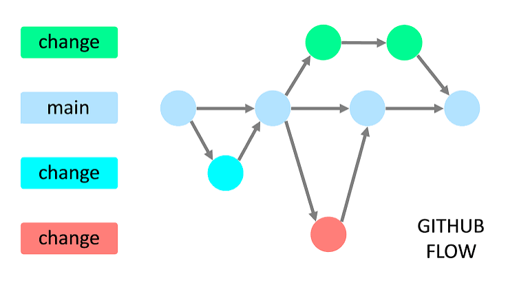

# Introducción a Git y GitHub

Material de la primera clase sobre control de versiones y trabajo colaborativo. Al finalizar deberías poder:

- Explicar qué es Git, qué es GitHub y en qué se diferencian.
- Entender qué es un repositorio, un commit y una rama.
- Trabajar con ramas y Pull Requests en equipo.
- Elegir una estrategia de merge y justificarla.
- Resolver un conflicto sencillo.

> Los comandos están resumidos en [`git-cheat-sheet.md`](git-cheat-sheet.md). Tenlo abierto durante la práctica.

---

## Contenido

1. [¿Qué es Git?](#1-qué-es-git)
2. [¿Qué es GitHub?](#2-qué-es-github)
3. [Conceptos básicos](#3-conceptos-básicos)
4. [Herramientas](#4-herramientas)
5. [Estrategias de ramas: Git Flow y GitHub Flow](#5-estrategias-de-ramas-git-flow-y-github-flow)
6. [Pull Requests](#6-pull-requests)
7. [Estrategias de merge](#7-estrategias-de-merge)
8. [Conflictos de merge](#8-conflictos-de-merge)
9. [Convenciones del curso](#9-convenciones-del-curso)
10. [Práctica](#10-práctica)

---

## 1. ¿Qué es Git?

**Git** es un sistema de control de versiones distribuido. Registra los cambios que se hacen en los archivos de un proyecto a lo largo del tiempo, de modo que puedes:

- **Ver el historial**: quién cambió qué, cuándo y por qué.
- **Volver atrás** si algo se rompe.
- **Trabajar en paralelo**: varias personas modifican el mismo proyecto sin pisarse.
- **Experimentar sin miedo**, usando ramas que no afectan la versión estable.

Git corre en tu computador (de forma local) y no necesita internet para funcionar.

## 2. ¿Qué es GitHub?

**GitHub** es una plataforma web que aloja repositorios de Git en la nube y agrega herramientas de colaboración: Pull Requests, revisión de código, protección de ramas, automatización (Actions), entre otras.

| | Git | GitHub |
|---|---|---|
| Qué es | Herramienta de control de versiones | Plataforma que aloja repositorios Git |
| Dónde vive | En tu computador | En la nube |
| Se usa con | Línea de comandos o editor | Navegador (y también desde Git) |
| Sin el otro | Funciona solo | No tiene sentido sin Git |

> Existen alternativas a GitHub (GitLab, Bitbucket), pero el funcionamiento de Git es el mismo.

---

## 3. Conceptos básicos

### Repositorio

Una carpeta de proyecto que Git está rastreando, junto con todo su historial de cambios. Se crea con `git init` o se descarga con `git clone`.

### Local y remoto

- **Repositorio local**: la copia que está en tu computador.
- **Repositorio remoto**: la copia alojada en GitHub, compartida por todo el equipo.
- **`origin`**: el nombre por defecto que recibe el remoto desde el cual clonaste.

### Los tres estados de un archivo

```
Directorio de trabajo  --git add-->  Staging  --git commit-->  Repo local  --git push-->  Remoto
                                                                   <--git pull / fetch--
```

| Estado | Significado |
|---|---|
| **Modificado** | Cambiaste el archivo, pero Git aún no lo ha registrado. |
| **En staging** (*staged*) | Marcaste el cambio para incluirlo en el próximo commit. |
| **Commiteado** | El cambio quedó guardado en el historial local. |

Dos comandos que usarás todo el tiempo: `git status` (¿en qué estado está todo?) y `git diff` (¿qué cambió exactamente?).

### Commit

Una "foto" del proyecto en un momento dado, identificada por un **hash** (por ejemplo `a3f9c21`) y acompañada de autor, fecha y mensaje. Los commits forman una cadena: cada uno apunta al anterior.

### Rama (*branch*)

Una línea independiente de desarrollo. Técnicamente, es un **puntero** a un commit que avanza cada vez que haces un nuevo commit en ella. Permite trabajar en una función nueva sin tocar la versión estable.

### HEAD

El puntero que indica **dónde estás parado**: normalmente, la rama actual y su último commit.

### `.gitignore`

Un archivo en la raíz del repositorio que lista lo que Git **no** debe rastrear: dependencias (`node_modules/`), archivos de configuración local, contraseñas o llaves (`.env`), archivos temporales, etc.

> **Nunca subas contraseñas ni llaves API.** Si ocurre, borrar el archivo después no basta: hay que cambiar la credencial.

### `push`, `pull` y `fetch`

- `git push`: sube tus commits al remoto.
- `git fetch`: descarga los cambios del remoto, sin integrarlos.
- `git pull`: descarga **e integra** los cambios (equivale a `fetch` + `merge`).

---

## 4. Herramientas

- **Git Bash** (Windows) o la **terminal** (Mac/Linux): la forma más directa de usar Git. Git Bash viene incluido al instalar Git.
- **VS Code**: tiene un panel de control de código fuente, muestra diferencias y ayuda a resolver conflictos con botones.
- **Clientes gráficos** (GitHub Desktop, GitKraken): útiles para visualizar, pero conviene aprender también la terminal.
- **Autenticación con GitHub**: mediante token de acceso personal (HTTPS) o llave SSH.
- **Visualizador interactivo**: durante la clase usaremos una herramienta visual para ver cómo se mueven las ramas y los commits.

**Antes de la clase, verifica que tienes:**

- [ ] Git instalado (`git --version`).
- [ ] Nombre y correo configurados (`git config --list`).
- [ ] Cuenta de GitHub y acceso al repositorio de la clase.
- [ ] Autenticación funcionando (puedes hacer `git clone` del repo).

---

## 5. Estrategias de ramas: Git Flow y GitHub Flow

Un **flujo de ramas** es el acuerdo del equipo sobre qué ramas existen, para qué sirve cada una y cómo se integran los cambios.

### Git Flow

Un modelo con varias ramas de larga vida: `main` (versiones publicadas), `develop` (integración), y ramas de apoyo `feature/*`, `release/*` y `hotfix/*`. Pensado para proyectos con versiones planeadas y mantenimiento de varias versiones en paralelo.

<!-- INSERTAR IMAGEN: diagrama de Git Flow -->


### GitHub Flow

Un modelo simple: `main` siempre está estable, y cada cambio se hace en una **rama corta** que se integra mediante un Pull Request tras ser revisada.

<!-- INSERTAR IMAGEN: diagrama de GitHub Flow -->


### Comparación

| | Git Flow | GitHub Flow |
|---|---|---|
| Ramas principales | `main` y `develop` | Solo `main` |
| Ramas de apoyo | `feature`, `release`, `hotfix` | Ramas cortas por tarea |
| Complejidad | Alta | Baja |
| Ideal para | Releases planeados, varias versiones | Entrega continua, equipos pequeños |

---

## 6. Pull Requests

Un **Pull Request** (PR) es una solicitud para integrar los cambios de una rama en otra (por ejemplo, de `feature/PROJ-12-mi-nombre` a `dev`). No es un comando de Git, sino una función de GitHub.

Un PR tiene:

- **Rama origen** (*compare*): la que contiene tus cambios.
- **Rama destino** (*base*): la que los va a recibir.
- **Título y descripción**: qué cambia y por qué.
- **Revisión de código**: otros miembros del equipo comentan, piden cambios o aprueban.
- **Verificación de conflictos**: GitHub avisa si la rama no se puede integrar limpiamente.
- **Botón de merge**: al aprobarse, se elige la estrategia de integración.

**¿Para qué sirve?** Para que ningún cambio entre a una rama compartida sin que alguien más lo haya revisado. Por eso las ramas importantes (`main`, `dev`) suelen estar **protegidas**: no se puede hacer push directo, solo mediante PR.

---

## 7. Estrategias de merge

Cuando un PR se aprueba, GitHub ofrece tres formas de integrarlo. La diferencia está en **cómo queda el historial**.

> 🔎 **Visualización interactiva:** en este punto de la clase se muestra la herramienta visual para ver cómo se comporta cada estrategia.
>
> <!-- INSERTAR ENLACE A LA HERRAMIENTA -->
> Enlace: _[pendiente]_

### Merge commit (*Create a merge commit*)

Une las dos ramas con un **commit extra de merge**. Conserva todos los commits de la rama tal cual.

- Historial **no lineal**: se ven las ramas y sus commits originales.
- Útil cuando importa la trazabilidad de qué entró y cuándo.

### Squash and merge

**Aplasta todos los commits** del PR en **uno solo** en la rama destino.

- Historial **lineal**, con un commit por PR.
- Ideal cuando los commits de la rama son desordenados ("fix", "ahora sí", "typo").

### Rebase and merge

**Reaplica los commits** del PR encima de la rama destino, uno por uno, sin commit de merge.

- Historial **lineal**, pero conserva cada commit individual.
- Los commits son **copias con hashes nuevos**.
- Útil cuando los commits están limpios y bien escritos.

### Comparación

| | Merge commit | Squash | Rebase |
|---|---|---|---|
| Commits de la rama | Se conservan | Se aplastan en 1 | Se conservan (hashes nuevos) |
| Commit extra de merge | Sí | No | No |
| Historial | No lineal | Lineal | Lineal |
| Úsalo cuando | Importa la trazabilidad | Commits desordenados | Commits limpios y quieres historial lineal |

> **Regla de oro:** nunca hagas rebase de una rama que otras personas ya descargaron.

No hay una estrategia "correcta": es una **decisión del equipo** que debe quedar acordada y documentada.

---

## 8. Conflictos de merge

Un conflicto ocurre cuando **dos ramas modificaron la misma línea** y Git no puede decidir cuál versión conservar. Marca el archivo así:

```
<<<<<<< HEAD
Ana
=======
Luis
>>>>>>> feature/PROJ-13-luis
```

- Entre `<<<<<<<` y `=======`: la versión de la rama actual.
- Entre `=======` y `>>>>>>>`: la versión que llega.

**Para resolverlo:**

1. Edita el archivo y deja el resultado final.
2. **Borra** las tres líneas de marcadores.
3. `git add <archivo>`, luego `git commit` y `git push`.

Un conflicto **no es un error**: es Git pidiéndote que decidas.

---

## 9. Convenciones del curso

- **Ramas:** `feature/PROJ-12-descripcion`, `fix/PROJ-30-descripcion`. La clave de la historia de Jira va siempre en el nombre.
- **Commits:** cortos, en imperativo, explicando qué y por qué. Ejemplo: `PROJ-12: agrega validación de correo`.
- **Pull Requests:** título con la clave de Jira (`PROJ-12: agrega login`), descripción clara y al menos una aprobación antes de integrar.
- **Ramas protegidas:** no se hace push directo a `main` ni a `dev`.

---

## 10. Práctica

La práctica se realiza durante la clase, siguiendo las indicaciones del profesor.

---

## Referencias

- [Visualizador interactivo de Git](https://learngitbranching.js.org)
- Documentación oficial de Git: <https://git-scm.com/doc>
- Documentación de GitHub: <https://docs.github.com>
